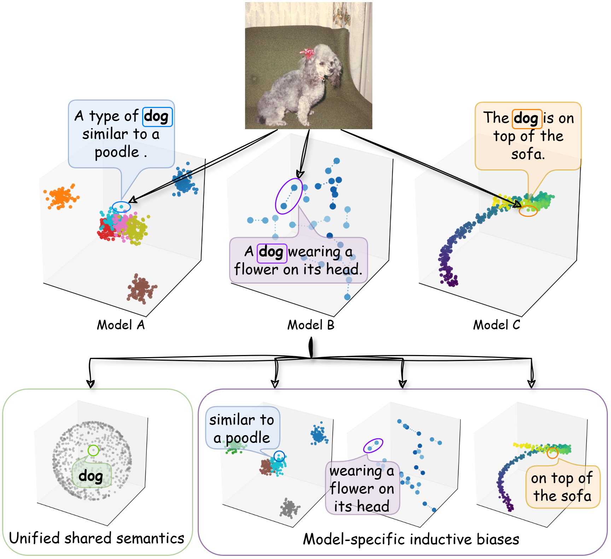
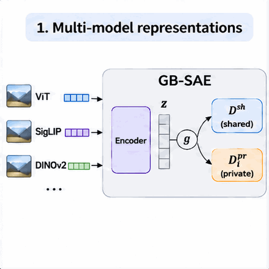

<div align="center">

# 🧠 GB-SAE

**Learning a Unified Cross-Model Semantic Dictionary via Gated Bottleneck Sparse Autoencoders**

Jinchi Zhu · Tie Luo


[](LICENSE)

[🚀 Getting started](#getting-started) · [🔍 Experiments](#explore-the-concepts) · [📖 Technical guide](TECHNICAL_GUIDE.md) · [📝 Citation and Paper](#citation)

</div>

<a id="motivation"></a>

## 💡 Different models, shared concepts

Different vision models can recognize the same dog while emphasizing different
details: its breed, an accessory, or the surrounding scene. **What do these models
understand in common, and what are specific to each model?**

GB-SAE learns a unified, interpretable concept space from multiple pretrained vision models.
It discovers **shared concepts** from all the models into a unified dictionary while retaining **private concepts** in separate dictionaries
that capture model-specific biases.

<p align="center">
  
</p>

## ⚙️ How it works

<p align="center">
  
</p>

1. 🧊 **Collect features** from frozen vision models and project them into a common space.
2. 🧩 **Find sparse concepts** with a shared encoder and a learned gate that divides their contributions into shared and private parts.
3. 🔎 **Reconstruct and interpret** each model's features using a shared dictionary and its own private dictionary.

The backbone models remain frozen. The repository includes training recipes for
ViT, SigLIP, DINOv2 and ConvNeXt ensembles.

<a id="getting-started"></a>

## 🚀 Getting started

### 🛠️ Install

Use Python 3.10+ with a compatible PyTorch/torchvision installation. From the
repository root, run:

```bash
python -m pip install -e .
```

### 🏋️ Train your own model

First, prepare images and cache the frozen backbone features using the
[data preparation instructions](TECHNICAL_GUIDE.md#1-prepare-images-and-frozen-features).
Set the image/cache paths in your training YAML, then run:

```bash
python -m gbsae.train --config configs/train/config_i.yaml
```

The supplied recipes use ImageNet. Other datasets can be used by adapting the
activation dataset loader. See the [technical guide](TECHNICAL_GUIDE.md) for the
complete setup and [configuration guide](configs/README.md) for all parameters.

<a id="explore-the-concepts"></a>

## 🔍 Explore the concepts

With a trained GB-SAE checkpoint and the corresponding cached features, choose
what you want to explore:

| I want to… | Start here |
| --- | --- |
| 🎨 **See what a concept responds to** | [Concept heatmaps and top-activating images](experiments/visualization/README.md) |
| 🎯 **Measure how concepts affect predictions** | [Sufficiency, comprehensiveness and a random baseline](experiments/attribution/README.md) |
| 📊 **Compare representations across models** | [Reconstruction and cross-model retrieval](experiments/main_metrics/README.md) |
| 🧪 **Use shared concepts for classification or retrieval** | [Classification](experiments/downstream/downstream_classification/README.md) · [Retrieval](experiments/downstream/downstream_retrieval/README.md) |
| 🔌 **Connect a new model to the learned dictionary** | [New-model adaptation](experiments/unseen_model/README.md) |

For example, to visualize shared and private concepts, set the checkpoint and
data paths in the [visualization YAML](configs/experiments/visualization/concepts.yaml), then run:

```bash
python -m experiments.visualization.concepts --config configs/experiments/visualization/concepts.yaml
```

## 📖 Go deeper

| Guide | What's inside |
| --- | --- |
| [Technical guide](TECHNICAL_GUIDE.md) | Complete workflow, commands, path conventions and repository layout |
| [GB-SAE](gbsae/README.md) | Model API, training and token alignment |
| [Feature caching](cache/README.md) | Extracting, combining and checking frozen features |
| [Configuration](configs/README.md) | Training recipes and parameter reference |
| [Classification-head API](experiments/classification_head/README.md) | Building classifiers on frozen representations |

<a id="citation"></a>

## 📝 Citation

If you find this work useful in your research, please cite:

```bibtex
@article{zhu2026gbsae,
  title={Learning a Unified Cross-Model Semantic Dictionary via Gated Bottleneck Sparse Autoencoders},
  author={Zhu, Jinchi and Luo, Tie},
  journal={Advances in Neural Information Processing Systems},
  year={2026}
}
```
[Check out paper here](https://arxiv.org/abs/2611.10503).

## 🙏 Acknowledgments

This project adapts components from
[Overcomplete](https://github.com/KempnerInstitute/overcomplete) and
[UniversalSAE](https://github.com/yorkucvil/UniversalSAE). See
[third-party notices](THIRD_PARTY_NOTICES.md) for details.

## 📜 License

Copyright (c) 2026 Jinchi Zhu and Tie Luo. GB-SAE-specific code and additions use
the [PolyForm Noncommercial License 1.0.0](LICENSE), permitting noncommercial
research and other uses allowed by its terms. Commercial uses outside those
permissions require a separate agreement with the authors. Third-party components
retain their original licenses; see [THIRD_PARTY_NOTICES.md](THIRD_PARTY_NOTICES.md).
